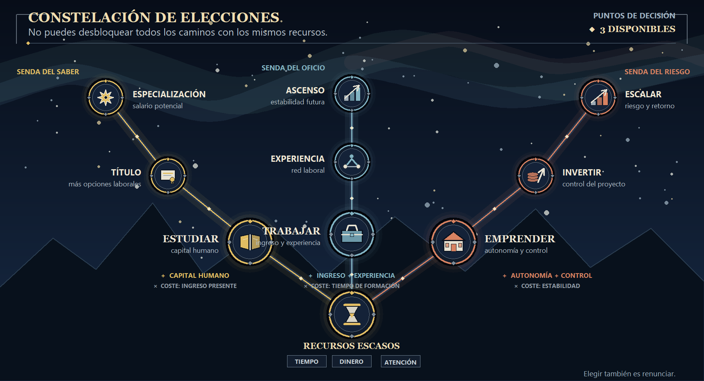
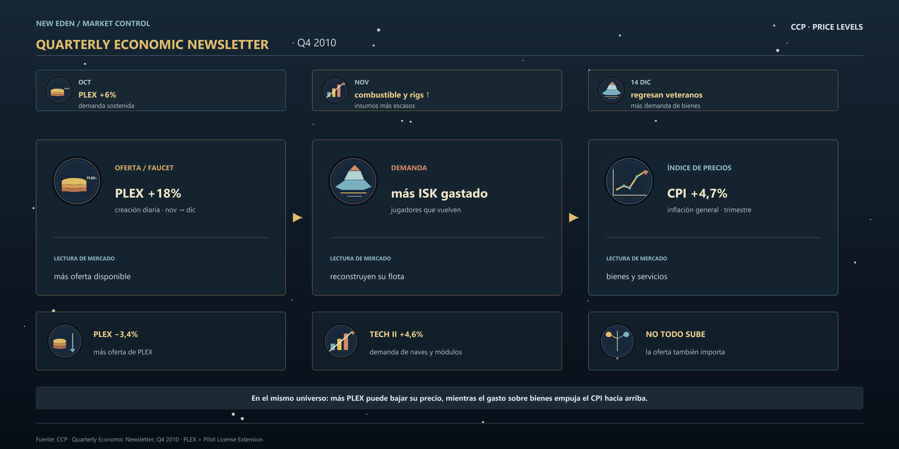

<style>
.game-visual {
  margin: 1.25rem 0 2.4rem;
}

.game-visual-title {
  color: #d8b66a;
  font-size: .78rem;
  letter-spacing: .16em;
  text-transform: uppercase;
  margin-bottom: .45rem;
}

.game-visual-subtitle {
  color: #c9c0ae;
  font-size: .95rem;
  margin-bottom: .8rem;
}

.constellation-wrap {
  border: 1px solid #5d5a4e;
  box-shadow: 8px 8px 0 rgba(38, 37, 31, .16);
}

.constellation-wrap {
  background: #0b1020;
  overflow: hidden;
}

.constellation-raster {
  display: block;
  width: 100%;
  height: auto;
}

.eve-raster {
  display: block;
  width: 100%;
  height: auto;
}
</style>

<div class="game-visual game-map">
<div class="game-visual-title">01 · Territorio y ventaja comparativa</div>
<div class="game-visual-subtitle">Cada provincia recibe una especialización según la actividad que más empleo concentra</div>

```{r}
#| label: fig-mapa-videojuegos-rd
#| fig-cap: "Tablero hexagonal provincial de República Dominicana; el icono indica la rama CNAE que concentra más empleo observado en cada provincia."
#| echo: false
#| warning: false
#| message: false
#| fig-width: 10
#| fig-height: 7
#| dev: png

library(sf)
library(dplyr)
library(ggplot2)
library(here)
library(grid)
library(png)

rd <- sf::st_read(
  here::here("mapa_rd/provincia/PROVCenso2010.shp"),
  quiet = TRUE,
  stringsAsFactors = FALSE
) |>
  sf::st_make_valid() |>
  sf::st_transform(32619)

activity <- read.csv(
  here::here("research/mercado-laboral-dominicano/data/processed/actividad-provincia-censo-2022.csv"),
  stringsAsFactors = FALSE,
  fileEncoding = "UTF-8"
)
activity$provincia <- sprintf("%02d", as.integer(activity$provincia))
if (nrow(activity) != 32L || anyDuplicated(activity$provincia)) {
  stop("La tabla provincial de actividades no tiene las 32 provincias esperadas.")
}
rd$PROV <- sprintf("%02d", as.integer(rd$PROV))
rd <- dplyr::left_join(rd, activity, by = c("PROV" = "provincia"))
if (anyNA(rd$sector)) stop("Hay provincias sin actividad dominante enlazada.")

rd_union <- sf::st_union(rd)
grid_geom <- sf::st_make_grid(rd_union, cellsize = 30000, square = FALSE)
hex <- sf::st_sf(tile_id = seq_along(grid_geom), geometry = grid_geom) |>
  sf::st_intersection(sf::st_sf(geometry = rd_union))
if (nrow(hex) < 5) stop("El tablero no genero suficientes hexagonos.")

hex_ll <- sf::st_transform(hex, 4326)
hex_xy <- sf::st_coordinates(sf::st_point_on_surface(hex_ll))
coast <- lengths(sf::st_intersects(hex_ll, sf::st_boundary(sf::st_union(hex_ll)))) > 0
hex$terrain <- dplyr::case_when(
  coast ~ "Costa",
  hex_xy[, 2] > 19.0 & hex_xy[, 1] < -70.1 ~ "Montana",
  hex_xy[, 1] < -70.45 & hex_xy[, 2] > 18.65 ~ "Bosque",
  hex_xy[, 2] > 18.5 & hex_xy[, 2] < 19.35 ~ "Cultivo",
  TRUE ~ "Llanura"
)
terrain_colors <- c(Costa = "#2f6074", Montana = "#b59872", Bosque = "#4e6b4e", Cultivo = "#a9a956", Llanura = "#8d985d")

centers <- sf::st_point_on_surface(rd)
center_xy <- sf::st_coordinates(centers)
centers_df <- data.frame(x = center_xy[, 1], y = center_xy[, 2], label = rd$PROV, sector = rd$sector)

base_map <- ggplot() +
  annotate("rect", xmin = -Inf, xmax = Inf, ymin = -Inf, ymax = Inf, fill = "#1e3a46") +
  geom_sf(data = hex, aes(fill = terrain), color = "#26352d", linewidth = .38) +
  geom_sf(data = rd, fill = NA, color = "#17261e", linewidth = .8) +
  scale_fill_manual(values = terrain_colors, name = "Terreno") +
  coord_sf(expand = FALSE) +
  labs(
    title = "República Dominicana · tablero provincial",
    subtitle = "Cada ficha representa la actividad CNAE dominante por empleo observado en la provincia",
    caption = "Censo 2022. AGRO = agricultura/pesca · COM = comercio · PUB = administración · TUR = turismo · IND = manufactura. No es PIB provincial."
  ) +
  theme_void() +
  theme(
    legend.position = "bottom",
    legend.title = element_text(color = "#f7efe5", face = "bold"),
    legend.text = element_text(color = "#f7efe5"),
    plot.title = element_text(color = "#f7efe5", face = "bold", size = 16),
    plot.subtitle = element_text(color = "#d5d0c2", size = 10),
    plot.caption = element_text(color = "#d5d0c2", hjust = 0, size = 8.5),
    plot.background = element_rect(fill = "#1e3a46", color = NA),
    panel.background = element_rect(fill = "#1e3a46", color = NA)
  )

sector_short <- c(
  "Agricultura y pesca" = "AGRO",
  "Comercio" = "COM",
  "Administracion publica" = "PUB",
  "Turismo y comidas" = "TUR",
  "Manufactura" = "IND"
)
centers_df$short <- unname(sector_short[centers_df$sector])
centers_df$tag_fill <- unname(c(
  "Agricultura y pesca" = "#e0bd62",
  "Comercio" = "#9fc2cc",
  "Administracion publica" = "#c5c0b8",
  "Turismo y comidas" = "#df8862",
  "Manufactura" = "#c39a70"
)[centers_df$sector])
sprite_dir <- here::here("posts/fundamentos/2026-07-25-videojuegos-y-economia/assets/mapa")
sprite_files <- c(
  "Agricultura y pesca" = file.path(sprite_dir, "sprite-agriculture.png"),
  "Comercio" = file.path(sprite_dir, "sprite-commerce.png"),
  "Administracion publica" = file.path(sprite_dir, "sprite-public.png"),
  "Turismo y comidas" = file.path(sprite_dir, "sprite-tourism.png"),
  "Manufactura" = file.path(sprite_dir, "sprite-manufacturing.png")
)
if (!all(file.exists(sprite_files))) stop("Faltan sprites del mapa: ", paste(names(sprite_files)[!file.exists(sprite_files)], collapse = ", "))

map_with_sprites <- base_map
for (i in seq_len(nrow(centers_df))) {
  map_with_sprites <- map_with_sprites + annotation_raster(
    png::readPNG(sprite_files[[centers_df$sector[[i]]]]),
    xmin = centers_df$x[[i]] - 15000,
    xmax = centers_df$x[[i]] + 15000,
    ymin = centers_df$y[[i]] - 15000,
    ymax = centers_df$y[[i]] + 15000,
    interpolate = TRUE
  )
}

map_with_sprites +
  geom_label(
    data = centers_df,
    aes(x = x, y = y - 19000, label = short),
    fill = centers_df$tag_fill,
    color = "#16252b",
    size = 1.75,
    fontface = "bold",
    linewidth = .25,
    label.padding = grid::unit(.13, "lines"),
    inherit.aes = FALSE
  ) +
  geom_text(data = centers_df, aes(x = x, y = y - 33000, label = label), color = "#f7efe5", size = 1.75, fontface = "bold", inherit.aes = FALSE)
```
</div>

<div class="game-visual">
<div class="game-visual-title">02 · Constelación de decisiones</div>
<div class="game-visual-subtitle">El coste de oportunidad como árbol de habilidades de la vida real</div>

<div class="constellation-wrap" role="img" aria-label="Árbol de decisiones con rutas de estudiar, trabajar y emprender">

</div>
</div>

<div class="game-visual">
<div class="game-visual-title">03 · La economía de un MMO real</div>
<div class="game-visual-subtitle">EVE Online, Q4 2010: faucets, demanda y un índice de precios</div>


<!-- Fuente: https://cdn1.eveonline.com/community/QEN/QEN_Q4-2010.pdf; imagen: scripts/build-inflation.py -->
</div>
