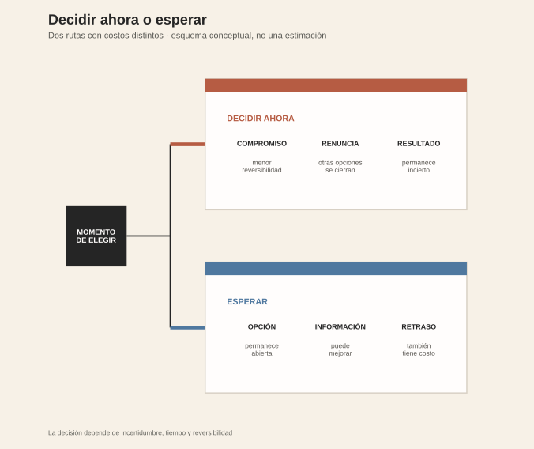

<!-- Borrador visual. La narrativa se añadirá después. -->

<figure class="article-figure"><figcaption>Bifurcación, tiempo y elección.</figcaption></figure>
<figure class="article-figure"><figcaption>Decidir ahora y esperar tienen costos diferentes.</figcaption></figure>

## Fuentes y materiales

- [Constructor de figuras](../../../research/build-kierkegaard-decision.R)
- [Mapa de figuras](../../../research/kierkegaard-decision/chart-map.csv)
