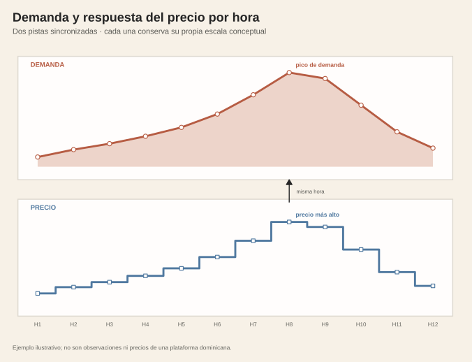
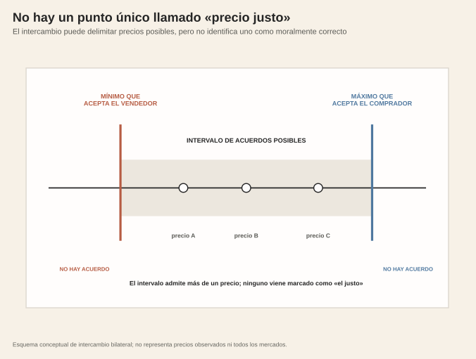

<!-- Borrador visual. La narrativa se añadirá después. -->

<figure class="article-figure"><figcaption>Precio justo y precio dinámico representados como fuerzas distintas sobre una balanza.</figcaption></figure>
<figure class="article-figure"><figcaption>Demanda y precio dinámico en un esquema ilustrativo.</figcaption></figure>
<figure class="article-figure"><figcaption>El intercambio admite varios precios posibles y no identifica uno como moralmente justo.</figcaption></figure>

## Fuentes y materiales

- [Constructor de figuras](../../../research/build-precio-justo-pricing-dinamico.R)
- [Mapa de figuras](../../../research/precio-justo-pricing-dinamico/chart-map.csv)
