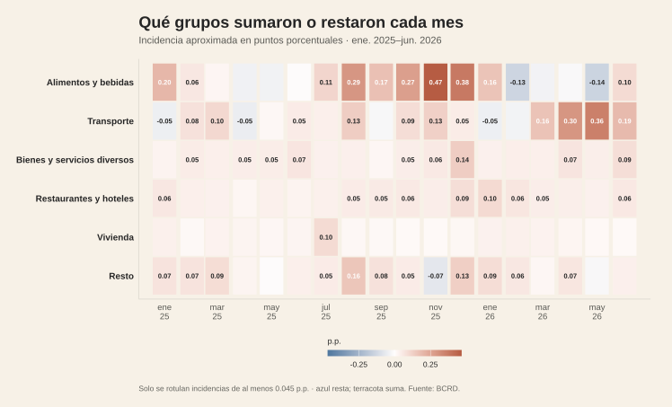
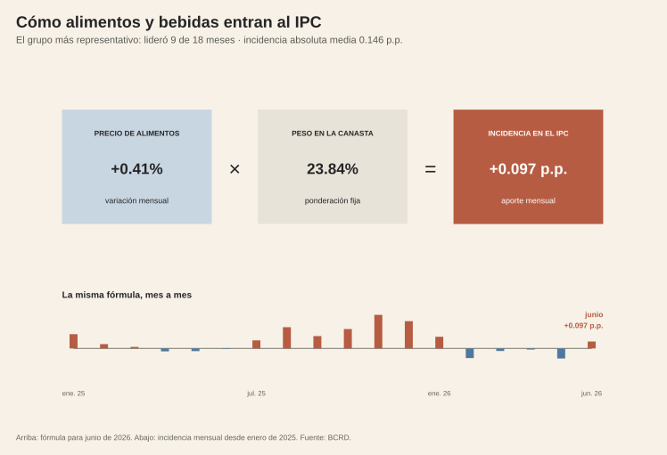
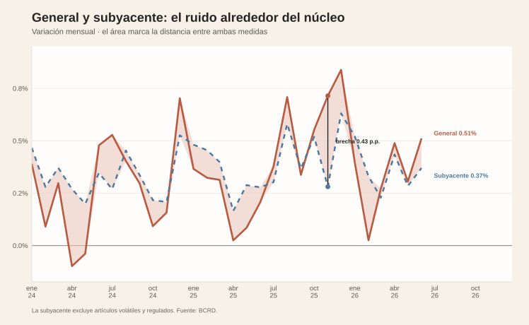
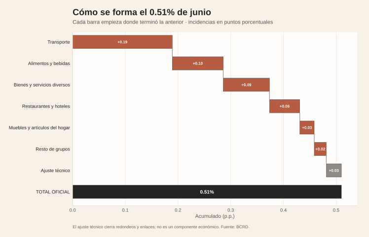
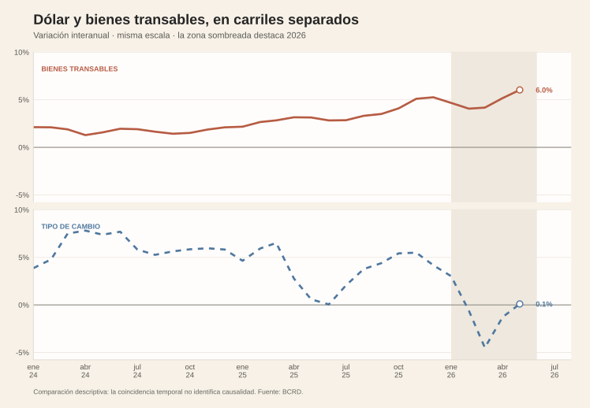

<script>document.body.classList.add('editorial-post');</script>

```{=html}
<figure class="article-figure"><figcaption>Los motores del IPC cambian de un mes a otro.</figcaption></figure>
<figure class="article-figure"><figcaption>Alimentos y bebidas es el grupo más representativo del período analizado.</figcaption></figure>
<figure class="article-figure"><figcaption>La distancia entre la inflación general y su núcleo varía con los choques mensuales.</figcaption></figure>
<figure class="article-figure"><figcaption>Las incidencias de junio cierran en el total oficial.</figcaption></figure>
<figure class="article-figure"><figcaption>Dólar y transables se comparan en la misma escala sin presuponer causalidad.</figcaption></figure>
```

## Fuentes y materiales reproducibles

- [Constructor de figuras revisadas](../../../research/build-pollo-inflacion-redesign.R)
- [Constructor general y datos fuente](../../../research/build-inflation-graphics.R)
- [Datos procesados](../../../research/pollo-inflacion/data/procesados/)
- [Mapa de figuras](../../../research/pollo-inflacion/chart-map.csv)
- [Informe IPC de junio de 2026 del BCRD](https://www.bancentral.gov.do/a/d/6611)
- [Consulta del IPC del BCRD](https://www.bancentral.gov.do/a/ipc-consulta)
